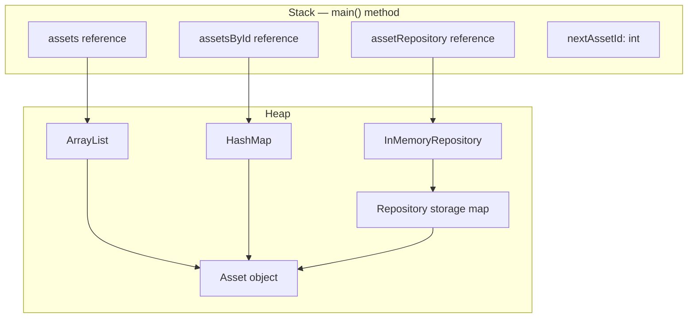

# IAMS Memory Management Review

## Business Method Reviewed
Asset Registration — `AssetManagementMenu.main()`

## Memory Pitfalls and Observations

1. **Multiple references to the same object:** Registered assets are stored in the repository, asset list, and ID map. These structures reference the same `Asset` object rather than creating separate copies.

2. **Redundant collection storage:** Assignments, requests, maintenance records, and software licences are maintained in repositories and separate collections. This increases collection overhead and requires updates to remain consistent.

3. **Temporary collection allocation:** The asset-viewing feature creates a new `ArrayList` copy before sorting. The temporary list uses additional memory, which is reasonable for small datasets.

4. **Collection growth:** In-memory collections grow as users register assets and create records. This is expected, but memory usage will increase with the amount of retained data.

5. **Queue retention:** Pending requests are stored in an `ArrayDeque`. Approved and rejected requests are removed from the pending queue, while the request history remains available through other collections.

6. **Resource handling:** The CSV loader uses try-with-resources for its reader. The scanner is closed when the application exits normally or when initial CSV loading fails.

7. **Garbage collection:** Registered objects remain reachable through the collections. They cannot be reclaimed while those references remain reachable.

## Stack and Heap Diagram

## Recommended Improvements

- Use repositories as the primary source of truth where practical.
- Retain additional collections only when their lookup or processing benefits justify their overhead.
- Review collection growth if the application is extended to manage large datasets.
- Use profiling or heap analysis before claiming that an actual memory leak exists.

## Conclusion

The main memory consideration in the current IAMS console application is the use of multiple in-memory collections to maintain references to the same business entities. This is not necessarily a memory leak, but reducing unnecessary duplication of collection structures could simplify memory management and improve maintainability.