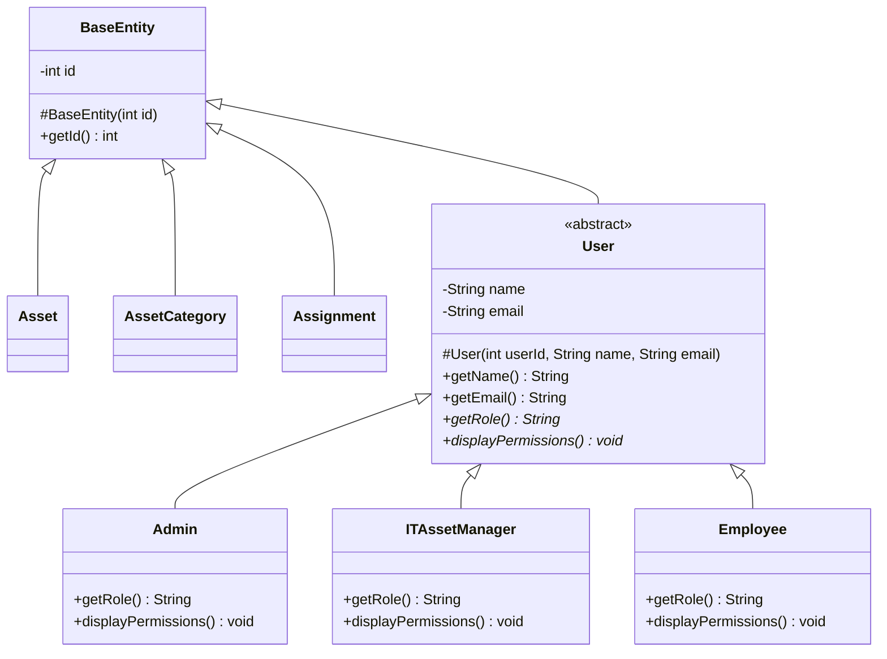
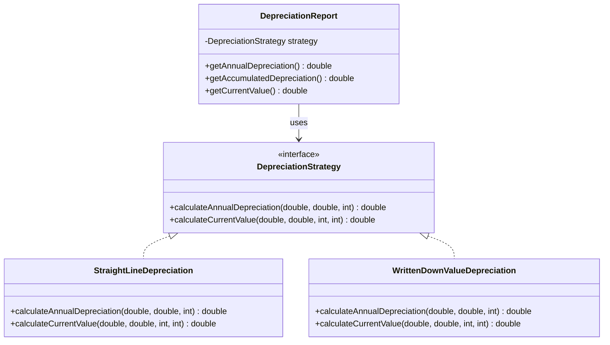

# IAMS — UML Class Diagram

## 1. Entity and User Inheritance

## 2. Depreciation Strategy Pattern

## Design Concepts

- **Inheritance:** `Asset`, `AssetCategory`, `Assignment`, and `User` inherit the common ID field from `BaseEntity`.
- **Abstraction:** `User` defines common user details and abstract role-specific methods.
- **Polymorphism:** `Admin`, `ITAssetManager`, and `Employee` provide their own implementations of `getRole()` and `displayPermissions()`.
- **Interface:** `DepreciationStrategy` defines the operations required for depreciation calculations.
- **Strategy pattern:** `StraightLineDepreciation` and `WrittenDownValueDepreciation` implement alternative depreciation algorithms.
- **Dependency:** `DepreciationReport` uses a `DepreciationStrategy` to calculate depreciation.